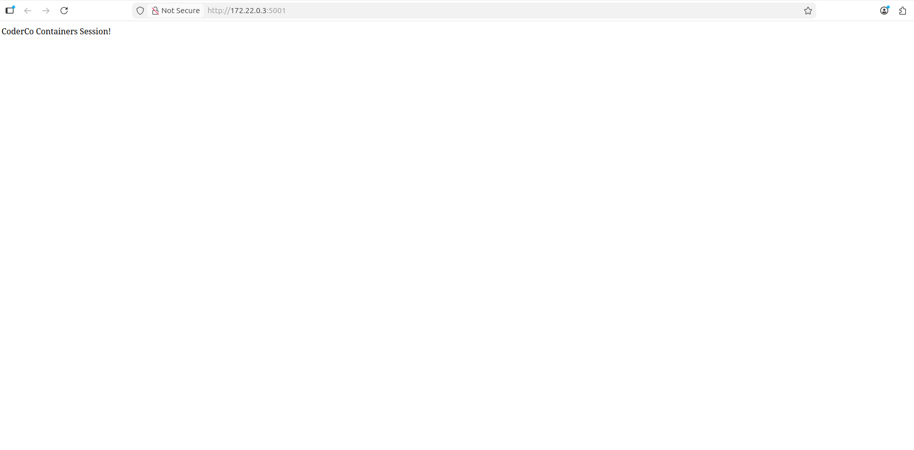
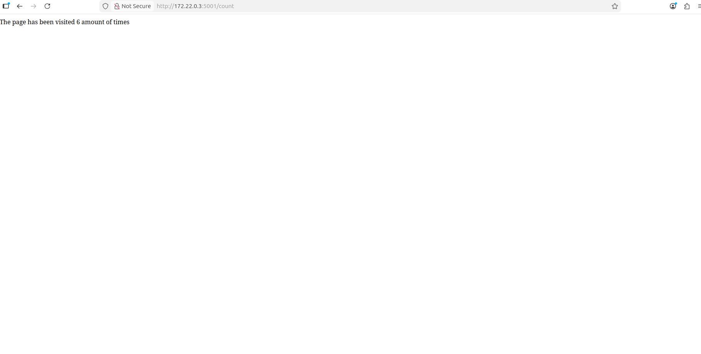

# Flask, Redis and Docker Compose Project

## Project overview

For this module, I practised packaging Flask applications with Docker. I started with a Flask and MySQL exercise in `hello_flask/`, then built a two-service visit counter in `coderco-challenge/` using Flask, Redis and Docker Compose.

The purpose of the challenge was to learn how to build application images, connect containers on a Compose network and make a web app available through a published port.

## What I built

| Component | Details |
|---|---|
| Intro exercise | Flask application, MySQL connection and a multi-stage Python Dockerfile in `hello_flask/` |
| Challenge web service | Flask application in `coderco-challenge/app.py` |
| Challenge data service | Redis, built from `coderco-challenge/redis/Dockerfile` |
| Orchestration | `coderco-challenge/docker-compose.yml` |
| Welcome route | `/` displays `CoderCo Containers Session!` |
| Counter route | `/count` increments a value in Redis and displays the visit count |
| Browser port | `5000` on the host maps to `5001` inside the Flask container |

## How the request works

```text
Browser → localhost:5000 → Flask container:5001 → Redis service:6379
```

Compose gives the containers a shared network. The Flask code connects to Redis using the service name `redis`, rather than a fixed container IP address.

## 1. Introductory Flask exercise

In `hello_flask/`, I practised a multi-stage Dockerfile. The build stage installs the Python dependencies in a virtual environment, and the runtime stage copies that environment and the application into a second image. The Flask application also connects to a MySQL service defined in its Compose file.

This folder contains the earlier exercise; the Redis counter below is the completed challenge.

## 2. Creating the Flask and Redis counter

In `coderco-challenge/app.py`, I added a welcome route and a `/count` route. Each visit to `/count` increments the Redis key `incrpage` and returns the updated number in the page response.

The Flask application connects to host `redis` on port `6379`. This host name matches the Redis service in Compose.

<details>
<summary>View welcome page screenshot</summary>

<p></p>

</details>

## 3. Building the images

The challenge's Flask Dockerfile starts from Python 3.12, copies the application files, installs Flask and the Redis Python client, and starts `app.py` on port `5001`.

The Redis Dockerfile starts from the Redis image. Compose builds each service from its own Dockerfile.

## 4. Connecting the services with Compose

The Compose file defines `flask` and `redis`. The Flask service depends on Redis and publishes its internal port `5001` on host port `5000`. The Redis service is reachable by Flask over the Compose network.

| Service | Build context | Connection used |
|---|---|---|
| Flask | `coderco-challenge/` | Browser uses `localhost:5000` |
| Redis | `coderco-challenge/redis/` | Flask uses `redis:6379` |

## 5. Running and testing the application

From the repository root:

```bash
cd Docker/coderco-challenge
docker compose up --build
```

I opened the following pages in a browser:

```text
http://localhost:5000/
http://localhost:5000/count
```

Refreshing `/count` increases the Redis-backed number. The screenshots were captured using the container's network address; the published host address above is the usual way to access the app.

<details>
<summary>View counter screenshot</summary>

<p></p>

</details>

To stop a foreground Compose session, press `Ctrl+C`. If it was started in the background, run `docker compose down` from the challenge directory.

## Challenges and troubleshooting

I encountered Python indentation and syntax errors while adding the counter route. I used the Flask container logs to find the reported lines and corrected the function and return statement.

The Flask image initially could not use the Redis Python client. I checked the import and added the package to the image's install step. The Python package and the Redis service have different roles: one is the client library, while the other is the data store.

I first tried opening the container's port `5001` as if it were the host port. Checking the Compose mapping showed that the browser should use port `5000`. When a later code edit still showed the old response, I saved the file and rebuilt the image with `docker compose up --build`.

## What I learned

This project helped me understand:

- How a Dockerfile builds an image and Compose starts multiple services
- How to use a multi-stage Dockerfile in the introductory Flask exercise
- How containers find one another by Compose service name
- Why a browser uses the published host port rather than the container port
- How a Flask route can increment a value stored in Redis
- Why changes to code copied into an image require a new build
- How container logs help locate application errors

## Security considerations

- The challenge publishes the Flask port for local access; the Redis service has no published host port in its Compose file.
- The Flask development server is suitable for this local exercise. A production deployment would use an application server designed for production traffic.
- The introductory MySQL exercise includes a hard-coded practice password. I would move credentials out of the Compose file before deploying it beyond a local lab.

## Future improvements

The next improvements I would make are:

- Add a Redis volume if the count needs to survive removal of the Redis container
- Pin dependency versions and clean up unused files in the challenge folder
- Exclude the local `.venv` and other development files from future image builds and commits
- Improve the wording on the counter page and retake its screenshot
- Add a more polished page while keeping the Flask and Redis services separate

This project gave me practical experience with Docker images, Compose, container networking, Redis and debugging a multi-container application.
