# VPC, Public and Private EC2 Networking Project

## Project overview

For this assignment, I created a custom AWS VPC with public and private subnets. I launched an EC2 instance in each subnet, used the public instance as a bastion host to reach the private instance, and configured a NAT gateway for outbound internet access from the private subnet.

The purpose was to understand how subnet routes and security groups control access to AWS resources.

## What I built

| Component | Details |
|---|---|
| Cloud provider | AWS |
| Region | London, `eu-west-2` |
| VPC | `coderco-assignment1-vpc`, `10.0.0.0/16` |
| Public subnet | `10.0.1.0/24` |
| Private subnet | `10.0.2.0/24` |
| Operating system | Amazon Linux 2023 |
| Public instance | `coderco-a1-public-ec2`, also used as the bastion |
| Private instance | `coderco-a1-private-ec2`, with no public IPv4 address |
| Public internet route | Internet gateway attached to the VPC |
| Private outbound route | Public NAT gateway with an Elastic IP |
| Local machine | Ubuntu running in VirtualBox |

At the time of the successful tests, the public instance used `13.40.77.73` and the private instance used `10.0.2.219`. These are the addresses recorded during the lab.

## How the connections work

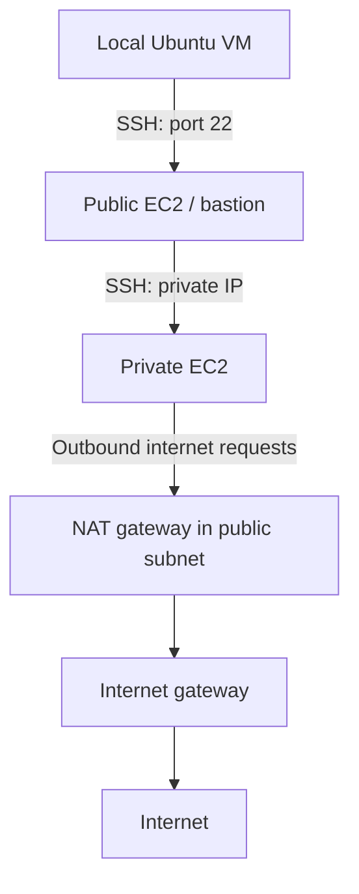

SSH access to the private instance goes through the bastion. The NAT gateway provides a separate path for connections that the private instance starts to the internet.

## 1. Creating the VPC and subnets

I created the VPC with CIDR block `10.0.0.0/16`, then added two subnets with different address ranges:

| Subnet | CIDR | Purpose |
|---|---|---|
| Public Subnet | `10.0.1.0/24` | Public EC2 instance and NAT gateway |
| PrivateSubnet | `10.0.2.0/24` | Private EC2 instance |

<details>
<summary>View private subnet screenshot</summary>

<p>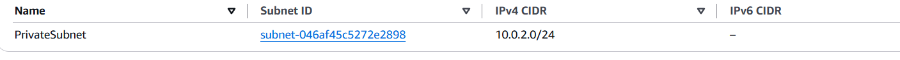</p>

</details>

## 2. Configuring the public route table

I attached an internet gateway to the VPC and configured the public subnet's route table:

| Destination | Target | Purpose |
|---|---|---|
| `10.0.0.0/16` | Local | Communication inside the VPC |
| `0.0.0.0/0` | Internet gateway | Route to the internet |

The public EC2 instance also needed a public IPv4 address and security group rules for the connections I wanted to allow.

## 3. Launching the public EC2 instance

I launched `coderco-a1-public-ec2` in the public subnet using Amazon Linux 2023.

<details>
<summary>View public EC2 instance screenshot</summary>

<p>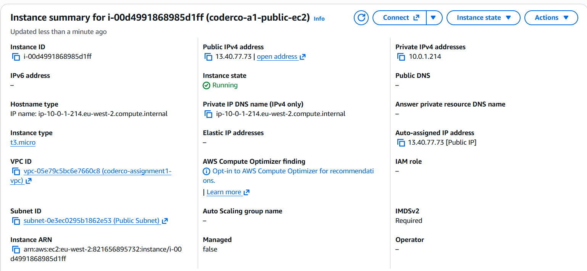</p>

</details>

I configured its security group with the following inbound rules:

| Type | Port | Source | Purpose |
|---|---:|---|---|
| SSH | 22 | My public IP address `/32` | Administration from my local machine |
| HTTP | 80 | My public IP address `/32` | Restrict HTTP access for the lab |

<details>
<summary>View public security group screenshot</summary>

<p>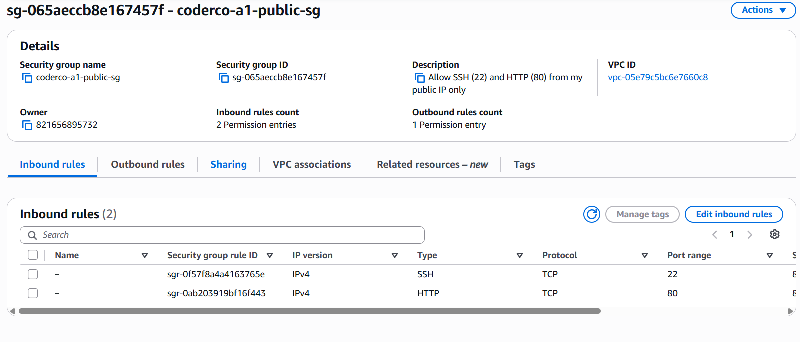</p>

</details>

The source IP had to match the public IP of my connection. The earlier screenshot records the initial configuration before the later SSH troubleshooting.

## 4. Connecting to the public instance

I connected from my Ubuntu VirtualBox machine using the private key stored locally:

```bash
ssh -i ~/.ssh/coderco-a1-keypair2.pem ec2-user@13.40.77.73
```

The terminal prompt changed to the EC2 user's session, confirming the connection.

<details>
<summary>View successful public SSH connection</summary>

<p>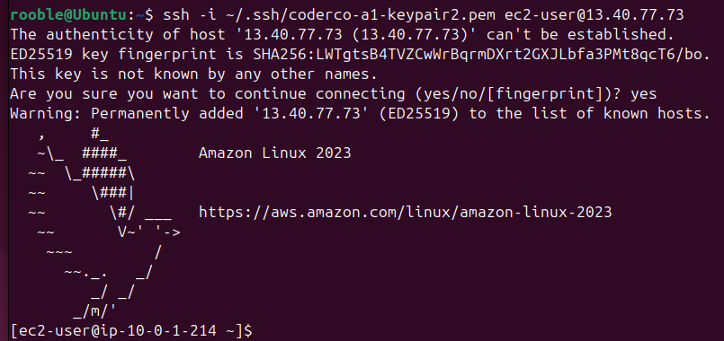</p>

</details>

## 5. Launching the private instance

I launched the private EC2 instance in `PrivateSubnet` with automatic public IPv4 assignment disabled.

Its security group allowed SSH on port 22 with the public instance's security group as the source. This let the bastion reach the private instance over the VPC network.

<details>
<summary>View private instance launch settings</summary>

<p>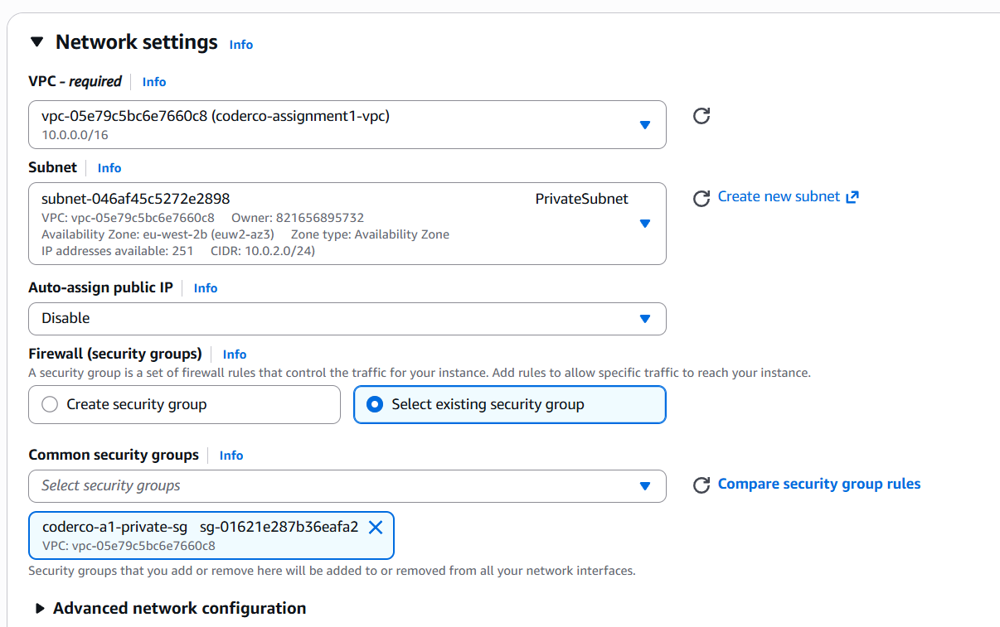</p>

</details>

<details>
<summary>View private SSH rule setup</summary>

<p>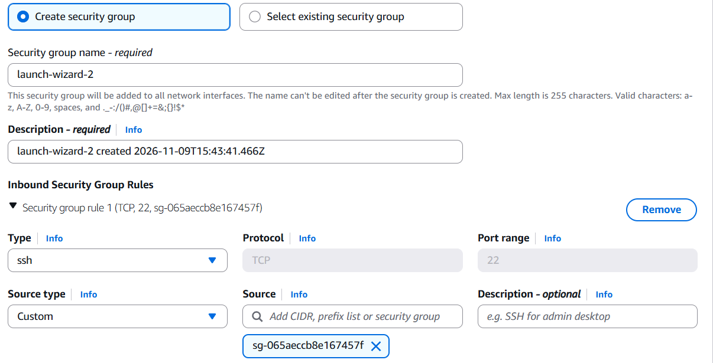</p>

</details>

## 6. Adding the NAT gateway

I created `coderco-a1-nat-gateway` in the public subnet with public connectivity and an Elastic IP allocation.

<details>
<summary>View NAT gateway setup</summary>

<p>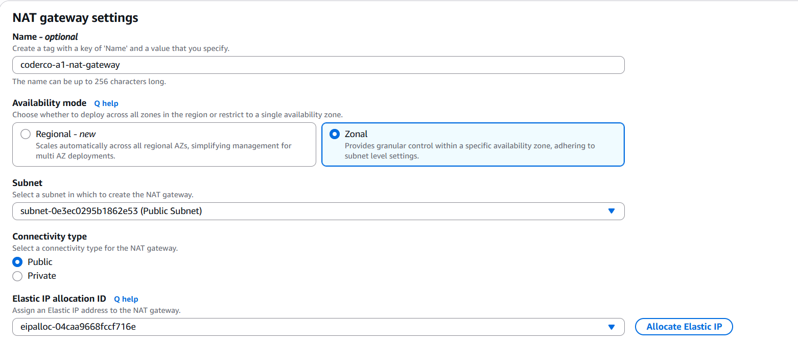</p>

</details>

I associated the private subnet with the private route table and added the default route to the NAT gateway:

| Destination | Target | Purpose |
|---|---|---|
| `10.0.0.0/16` | Local | Communication inside the VPC |
| `0.0.0.0/0` | NAT gateway | Outbound internet access |

<details>
<summary>View active private route table</summary>

<p>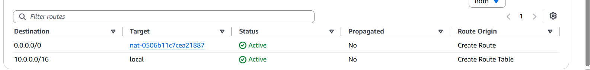</p>

</details>

## 7. Connecting through the bastion

I used SSH agent forwarding so the private key could stay on my local Ubuntu VM. I loaded the key into the local SSH agent, then connected to the public instance with forwarding enabled:

```bash
ssh -A ec2-user@13.40.77.73
```

From the public instance, I connected to the private instance using its private IP:

```bash
ssh ec2-user@10.0.2.219
```

<details>
<summary>View successful private SSH connection</summary>

<p>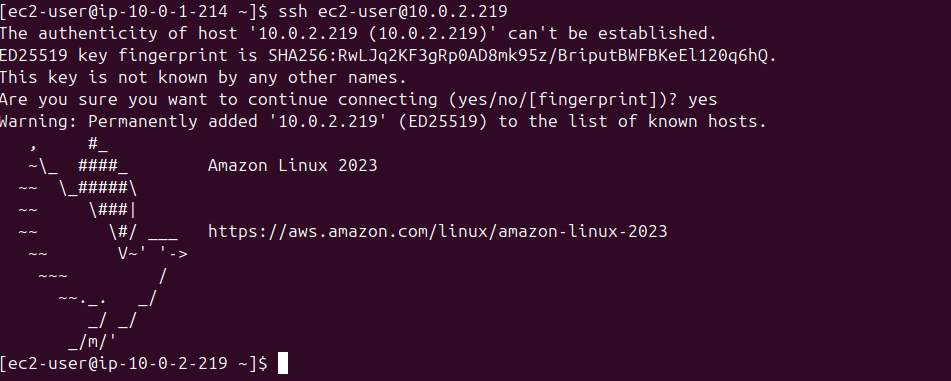</p>

</details>

## 8. Testing outbound internet access

From the private instance, I ran:

```bash
ping google.com
```

The name resolved and the instance received replies. This confirmed that DNS resolution and outbound internet connectivity were working for this test. I used `Ctrl+C` to stop the continuous ping.

<details>
<summary>View private instance internet test</summary>

<p>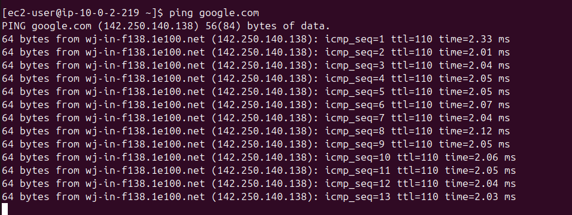</p>

</details>

## Challenges and troubleshooting

I first tried to find the Windows key file under `/mnt/c/Users`, but I was using VirtualBox. I accessed the file through a VirtualBox shared folder, copied it into my Ubuntu `.ssh` directory and restricted its permissions.

My public SSH connection also failed during setup. I checked my current public IP address and updated the SSH security group source to match it. The connection then succeeded.

The first private instance used a different key pair from the key available locally. I recreated that lab instance with the matching key pair. Its private IP changed from `10.0.2.96` to `10.0.2.219`, which is why the successful test screenshots use the latter address.

## What I learned

This project helped me understand:

- How VPC and subnet CIDR blocks fit together
- How a default route to an internet gateway makes a subnet public
- How security groups control which connections can reach an instance
- How a public instance can act as a bastion for private resources
- Why SSH authentication requires the matching private key
- How SSH agent forwarding supports a second connection without copying the private key to the bastion
- How a NAT gateway gives private instances outbound internet access
- How to test connectivity from the instance where the problem occurs

## Security considerations

- Public SSH and HTTP access were restricted to my own public IP address.
- The private instance had no public IPv4 address.
- Private SSH access used the bastion security group as its source.
- The private key stayed on my local VM and is not included in this folder.
- SSH agent forwarding was used for the lab's bastion connection; the bastion must be a trusted host.

## Future improvements

The next improvements I would make are:

- Rebuild the network using Terraform
- Add VPC Flow Logs to help investigate network problems
- Use Systems Manager Session Manager for administration
- Design the private outbound network across multiple Availability Zones
- Capture a complete architecture view and final route table screenshots
