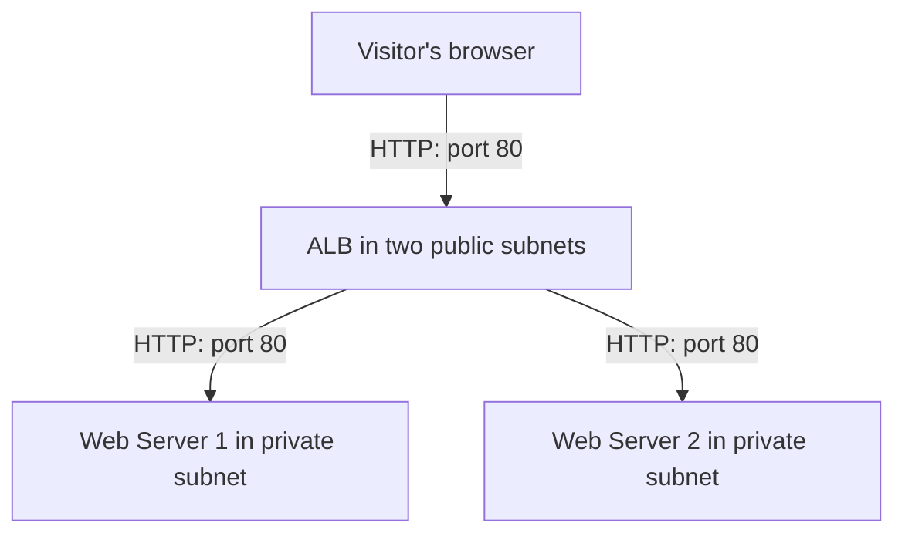
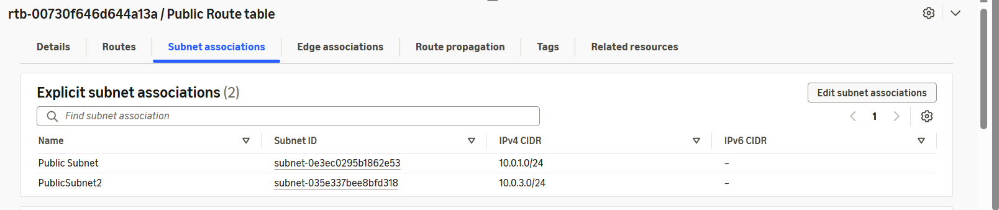
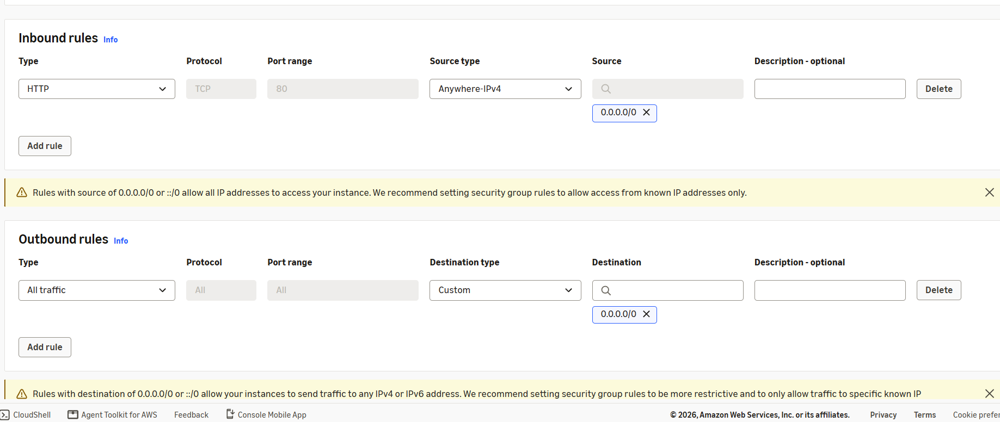
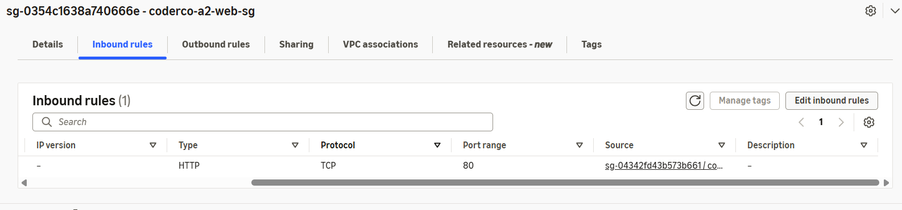
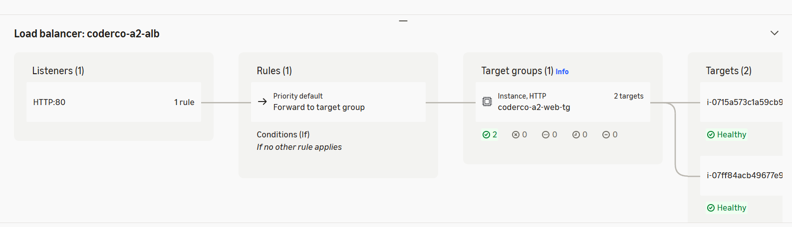
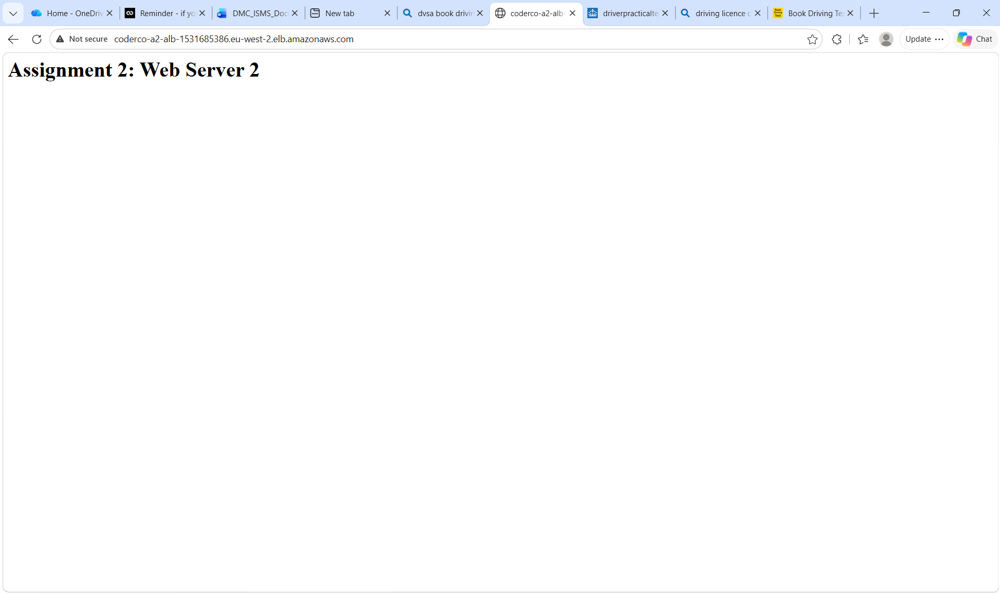
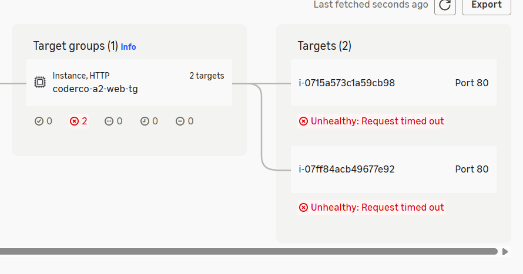
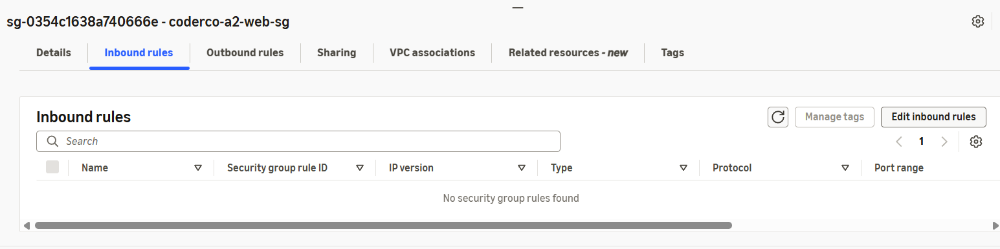

# Two EC2 Web Servers Behind an Application Load Balancer

## Project overview

For this assignment, I deployed two EC2 web servers behind an Application Load Balancer. The ALB accepted incoming HTTP requests and forwarded them to the private instances. Each instance returned different page content so I could test that both were receiving requests.

The purpose was to practise load balancing, health checks and security group isolation.

## What I built

| Component | Details |
|---|---|
| Cloud provider | AWS |
| Region | London, `eu-west-2` |
| VPC | Reused `coderco-assignment1-vpc` from Assignment 1 |
| Availability Zones | `eu-west-2b` and `eu-west-2a` |
| Web instances | `coderco-a2-web-1` and `coderco-a2-web-2` |
| Instance placement | One in each private subnet, with public IP assignment disabled |
| Operating system | Amazon Linux 2023 |
| Web server | Apache HTTP Server (`httpd`) |
| Load balancer | Internet-facing ALB, `coderco-a2-alb` |
| Listener | HTTP, port 80 |
| Target group | `coderco-a2-web-tg`, instance targets on port 80 |
| Health check | HTTP on the root path `/` |
| ALB security group | `coderco-a2-alb-sg` |
| Web security group | `coderco-a2-web-sg`, shared by both web instances |

## How the request works



The browser uses the ALB's DNS name. The ALB connects to the web servers using their private addresses. The NAT gateway from Assignment 1 provides outbound access for package installation; requests from the ALB to the web servers stay inside the VPC.

## 1. Preparing the subnets

I extended the existing VPC with a public subnet and a private subnet in a second Availability Zone:

| Subnet | CIDR | Availability Zone | Use |
|---|---|---|---|
| Public Subnet | `10.0.1.0/24` | `eu-west-2b` | ALB |
| PublicSubnet2 | `10.0.3.0/24` | `eu-west-2a` | ALB |
| PrivateSubnet | `10.0.2.0/24` | `eu-west-2b` | Web Server 1 |
| PrivateSubnet2 | `10.0.4.0/24` | `eu-west-2a` | Web Server 2 |

Both public subnets used the public route table with its default route to the internet gateway. Both private subnets used the private route table with its outbound route to the existing NAT gateway.

<details>
<summary>View public subnet associations</summary>

<p></p>

</details>

## 2. Launching the EC2 instances

I launched two Amazon Linux 2023 instances in the same VPC, using a different private subnet for each one. I disabled automatic public IP assignment and attached `coderco-a2-web-sg` to both instances.

I initially left this security group without inbound rules. After creating the ALB security group, I added the HTTP rule described below.

## 3. Installing Apache with user data

I used user data to install Apache, create the page and enable the service during the initial instance launch.

For **Web Server 1**, I used [web-1.sh](user-data/web-1.sh):

```bash
#!/bin/bash
dnf install -y httpd
echo '<h1>Assignment 2: Web Server 1</h1>' > /var/www/html/index.html
systemctl enable --now httpd
```

For **Web Server 2**, I used [web-2.sh](user-data/web-2.sh):

```bash
#!/bin/bash
dnf install -y httpd
echo '<h1>Assignment 2: Web Server 2</h1>' > /var/www/html/index.html
systemctl enable --now httpd
```

The different headings let me identify which instance answered a request. Outbound HTTPS access through the NAT gateway allowed the instances to download packages.

## 4. Configuring the security groups

I used a separate security group for the ALB and the web instances:

| Security group | Inbound type | Port | Source | Purpose |
|---|---|---:|---|---|
| `coderco-a2-alb-sg` | HTTP | 80 | `0.0.0.0/0` | Public access to the ALB |
| `coderco-a2-web-sg` | HTTP | 80 | `coderco-a2-alb-sg` | Web requests and health checks from the ALB |

The ALB kept its default outbound rule so it could connect to the instances. The web instances' inbound HTTP rule referenced the ALB security group rather than an internet IP range.

<details>
<summary>View ALB security group setup</summary>

<p></p>

</details>

<details>
<summary>View web security group allowing HTTP from the ALB only</summary>

<p></p>

</details>

The source shown in the web rule is `sg-04342fd43b573b661`, which is the ALB security group's ID.

## 5. Creating the target group and health check

I created `coderco-a2-web-tg` with target type **Instances**, protocol **HTTP** and port **80**, then registered both web instances.

I configured the HTTP health check on `/`. This path serves each instance's `index.html` page, so the check can verify that the web server responds successfully.

## 6. Creating the Application Load Balancer

I created `coderco-a2-alb` as an internet-facing ALB using IPv4. I selected both public subnets in the two Availability Zones and attached `coderco-a2-alb-sg`.

The listener used HTTP port 80 with a default action to forward requests to `coderco-a2-web-tg`.

<details>
<summary>View listener, target group and two healthy targets</summary>

<p></p>

</details>

## 7. Testing through the ALB DNS name

At the time of testing, I opened:

```text
http://coderco-a2-alb-1531685386.eu-west-2.elb.amazonaws.com
```

I refreshed the page and observed both **Assignment 2: Web Server 1** and **Assignment 2: Web Server 2** at the same address. This showed that both backend instances could serve requests through the ALB. The pages do not have to alternate on every individual refresh.

<details>
<summary>View Web Server 1 through the ALB</summary>

<p></p>

</details>

<details>
<summary>View Web Server 2 through the same ALB</summary>

<p></p>

</details>

## Challenges and troubleshooting

I initially launched the web instances without user data. I recreated the lab instances with the scripts entered before launch so Apache and the pages would be configured during the first boot.

After creating the ALB, both targets showed **Unhealthy: Request timed out**. I checked `coderco-a2-web-sg` and found that it still had no inbound rules. The ALB could not reach the web servers on port 80.

<details>
<summary>View failed health checks before the fix</summary>

<p></p>

</details>

<details>
<summary>View the missing inbound rule</summary>

<p></p>

</details>

I added HTTP port 80 inbound with `coderco-a2-alb-sg` as the source. After the health checks ran again, both targets became healthy and both pages were available through the ALB.

## What I learned

This project helped me understand:

- How an ALB accepts requests and forwards them to registered targets
- How a listener and target group fit together
- Why the ALB uses public subnets while the web servers can remain private
- How user data configures an instance during launch
- How different page content helps test requests reaching both instances
- How health checks identify whether the web servers are responding
- How one security group can be used as the source in another group's rule
- Why a running EC2 instance does not necessarily mean its web server is reachable

## Security considerations

- Public HTTP access was allowed on the ALB security group.
- The web instances had public IP assignment disabled.
- Their only inbound HTTP source was the ALB security group.
- The ALB communicated with the instances over their private addresses.
- The scripts in this folder contain no private keys or AWS credentials.
- This lab uses HTTP; HTTPS would be a further improvement.

## Future improvements

The next improvements I would make are:

- Add HTTPS with an ACM certificate and an HTTPS listener
- Connect a custom domain using Route 53
- Use an Auto Scaling group to manage the web instances
- Add monitoring and access logs
- Rebuild the resources using Terraform
- Capture the final instance placement and root health check settings alongside the existing test evidence
