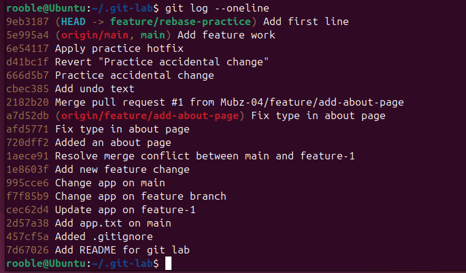
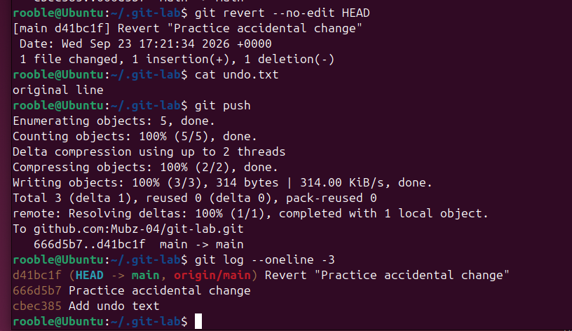
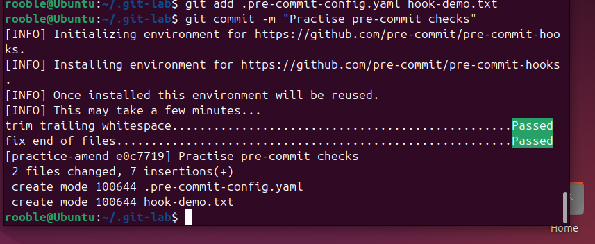
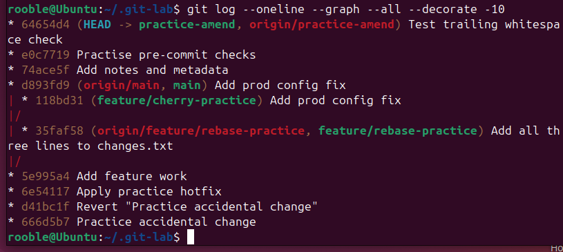

# Git and GitHub Practice

## Project overview

I used my [Git practice repository](https://github.com/Mubz-04/git-lab) to learn how Git tracks changes and how to work with branches and GitHub. I made commits, merged a pull request, resolved a conflict, tried different ways to undo mistakes, and experimented with tools for keeping history readable.

The aim was to become comfortable making changes without losing work, and to understand what happens when those changes are shared.

## What I practised

| Area | What I did |
|---|---|
| Everyday workflow | Checked status, staged files, committed and pushed changes |
| Branches | Created feature branches and merged work into `main` |
| GitHub | Opened and merged a pull request |
| Recovery | Used restore, reset, revert, stash and reflog |
| History | Squashed commits with interactive rebase and amended a commit |
| Other tools | Cherry-picked a commit, used `.gitignore` and ran pre-commit checks |

The repository contains small files I used for different exercises: `about.md` for the pull request, `app.txt` for merging, `feature.txt` for stash practice, `hotfix.txt` for a separate fix, and `undo.txt` for restore and revert. Its `.gitignore` includes `.env` and `.DS_Store`.

## How the workflow fits together

```text
Edit files → Stage with git add → Commit locally → Push to GitHub
```

I used `git status` throughout to see which files had changed and which changes were staged.

## 1. Branching and merging

I created branches for practice changes, then merged completed work into `main`. I also worked through a merge conflict and removed the conflict markers before completing the merge. On GitHub, I opened and merged a pull request for an about page.

```bash
git switch -c feature/example
git switch main
git merge feature/example
```

The history below includes the merge commit from that pull request.

<details>
<summary>View merge and branch history</summary>

<p></p>

</details>

## 2. Saving and recovering work

I used stash to put unfinished edits aside while working on something else, then brought them back later. I also practised different ways to undo changes:

| Situation | Command | What happens |
|---|---|---|
| Discard an unstaged edit | `git restore <file>` | Restores the committed version of that file |
| Unstage a file | `git restore --staged <file>` | Keeps the edit in the working directory |
| Undo a local commit, keep edits staged | `git reset --soft HEAD~1` | Moves the branch back one commit |
| Undo a local commit, keep edits unstaged | `git reset HEAD~1` | Keeps the file changes |
| Discard a local commit and its tracked changes | `git reset --hard HEAD~1` | Removes those changes from the working tree |
| Undo a shared commit | `git revert <commit>` | Creates a new commit that reverses it |

I deliberately pushed a mistake and used `git revert` to undo it. This kept the original commit in history and added a new commit recording the fix.

<details>
<summary>View revert and push result</summary>

<p></p>

</details>

## 3. Cleaning up commit history

I made three commits for three lines in `changes.txt`, then used interactive rebase to squash them into one commit. The file still contained all three lines. I also used `git commit --amend` to update the most recent commit.

```bash
git rebase -i HEAD~3
git commit --amend -m "Add all three lines to changes.txt"
```

Rebase and amend change commit IDs, so I would check whether other people are using the branch before rewriting shared history.

I also cherry-picked a single commit from a feature branch onto `main` instead of merging the whole branch.

<details>
<summary>View the rebase result in Git history</summary>

<p></p>

</details>

## 4. Ignoring files and checking commits

I used `.gitignore` to keep a practice `.env` file out of Git. I checked the matching ignore rule with:

```bash
git check-ignore -v .env
```

I also installed the pre-commit framework in my practice repository. The hooks checked trailing whitespace and whether files ended with a newline before accepting a commit.

<details>
<summary>View pre-commit checks passing</summary>

<p></p>

</details>

## 5. Reading the history

I used these commands to understand where my branches pointed and to find previous work:

```bash
git log --oneline --graph --all --decorate -10
git reflog
```

`git log` shows the commits reachable in the history being viewed. `git reflog` records local reference movements, which helped me see commits even after a reset.

<details>
<summary>View Git history graph</summary>

<p></p>

</details>

## Challenges and what I learned

At first I confused the working directory with the staging area. Practising `git status`, `git diff` and `git diff --staged` helped me see which changes would go into the next commit. I also learnt that `git restore --staged` only unstages an edit; it does not remove the edit from the file.

The undo commands took practice because they affect different things. My clearest takeaway is to use `git revert` for a change that has already been shared, and to inspect `git status` and `git log` before resetting a local branch.

## Next steps

- Keep using branches and pull requests in my other projects.
- Write clearer commit messages and review my changes before pushing.
- Add automated checks to future projects as I learn CI/CD.
